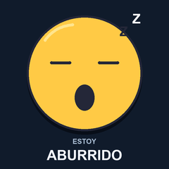
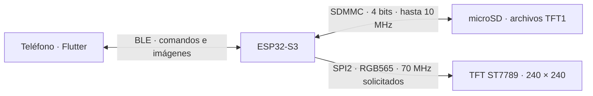
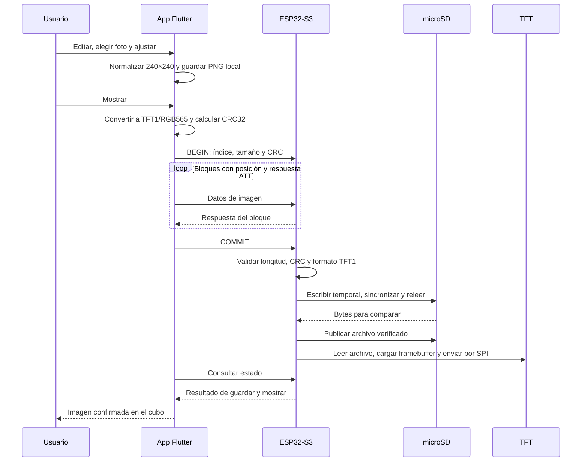

# Cubo Interactivo Pediátrico · ESP32-S3 + Flutter

El proyecto permite elegir una emoción desde el teléfono y mostrar su imagen en una TFT de 240 × 240 píxeles. Incluye 16 caras originales y permite sustituir cada una por una imagen de la galería. El teléfono se comunica directamente con el cubo por Bluetooth Low Energy (BLE), sin Internet ni servidor.

Este README reúne el funcionamiento del firmware ESP-IDF, la app Flutter, el almacenamiento y los formatos. Describe el código y las pruebas realizadas hasta el **21 de octubre de 2026**.

## Estado del proyecto

| Área | Implementado |
| --- | --- |
| TFT | Driver ST7789 en C, inicialización por SPI, colores sólidos, framebuffer y carga de imágenes TFT1 |
| microSD | Montaje FAT mediante SDMMC de 4 bits, instalación de originales, lectura y sustitución verificada de imágenes |
| Emociones | 16 caras, etiquetas «ESTOY…», copia de fábrica embebida y restauración desde la app |
| App Flutter | Selección única, galería, recorte central/acercamiento, vista previa y guardado local |
| BLE | Escaneo, conexión cifrada, comandos, transferencia por bloques, progreso, cancelación y confirmación |
| Editor de escritorio | `documents/index.html`: dibujo por píxeles, importación/exportación TFT y TXT, vista PNG |
| Verificación física | Android Moto g86 power 5G + ESP32-S3: envío personalizado, cancelación, restauración y reconexión |

El firmware mantiene fija la cara elegida; ya no ejecuta el carrusel de prueba. Al encender lee el archivo `joy.tft` de la SD: puede ser la cara original o su personalización. No recuerda el índice de la última emoción seleccionada antes de apagar.

## Organización del repositorio

```text
Cubo_Interactivo_Pediatrico_ESP32_S3/
├── README.md                              ← este documento general
├── Cubo_Interactivo_Esp_32_S3/              ← firmware ESP-IDF
│   ├── componentes/driver/spi_manager/
│   │   ├── bus_spi.c / .h                 ← bus SPI de la TFT
│   │   └── bus_sdmmc.c / .h               ← bus SDMMC de la microSD
│   ├── componentes/modules/
│   │   ├── st7789/                        ← pantalla y framebuffer
│   │   └── microSD/                       ← FAT, archivos y publicación segura
│   ├── main/app/emotions/                 ← catálogo e instalación/restauración
│   ├── main/app/ble/                      ← servidor NimBLE y tarea de comandos
│   ├── main/app/power_button/             ← reservado; control de botón pendiente
│   ├── main/assets/emotions/              ← 16 originales binarios TFT1
│   ├── main/assets/drawing.tft            ← dibujo de respaldo en flash
│   ├── output/emotions/                   ← vistas PNG, manifiesto y ZIP para SD
│   ├── partitions/partitions.csv
│   └── sdkconfig.defaults
├── app_control_cubo_interactivo/           ← app Flutter
│   ├── lib/screens/                       ← emociones, editor y escáner
│   ├── lib/services/                      ← BLE, imágenes y almacenamiento local
│   ├── assets/emotions/                   ← originales PNG para la interfaz
│   ├── test/                              ← pruebas de widgets y formato
│   └── integration_test/                  ← prueba BLE con hardware
└── documents/index.html                   ← TFT Pixel Studio, editor sin conexión
```

## Las 16 caras originales

Estas vistas PNG representan los mismos dibujos que los archivos TFT1 incorporados al firmware. Los textos son parte de los píxeles de cada imagen; no se dibujan como fuentes separadas en el ESP32.

| | | | |
| --- | --- | --- | --- |
| <br>0 · **Feliz** · `joy.tft` | <br>1 · **Triste** · `sad.tft` | <br>2 · **Enfadado** · `angry.tft` | <br>3 · **Molesto** · `upset.tft` |
| <br>4 · **Serio** · `serious.tft` | <br>5 · **Avergonzado** · `sorry.tft` | <br>6 · **Emocionado** · `excited.tft` | <br>7 · **Enamorado** · `inlove.tft` |
| <br>8 · **Nervioso** · `nervous.tft` | <br>9 · **Pensativo** · `thought.tft` | <br>10 · **Aburrido** · `bored.tft` | <br>11 · **Sorprendido** · `surprise.tft` |
| <br>12 · **Preocupado** · `worried.tft` | <br>13 · **Asustado** · `scared.tft` | <br>14 · **Deprimido** · `crying.tft` | <br>15 · **Orgulloso** · `proud.tft` |

Los índices 0–15 son compartidos por la app y el firmware. Los nombres cortos de archivo son compatibles con FAT 8.3. Cada emoción tiene un único archivo activo en `/sdcard/emotions/`; personalizarla sustituye ese archivo, no agrega otra emoción.

## Hardware: tres comunicaciones diferentes



La SD y la TFT usan periféricos y pines diferentes. Aunque ambos drivers están organizados dentro de `spi_manager`, **la microSD está conectada por SDMMC**, no por SPI. BLE transporta información entre teléfono y ESP32; después el ESP32 utiliza SDMMC para el archivo y SPI para la pantalla.

| Recurso | Configuración actual y propósito |
| --- | --- |
| Placa | Waveshare ESP32-S3-LCD-1.54 |
| Framework | ESP-IDF 5.5.4, target `esp32s3` |
| Flash interna | 16 MB: firmware, originales embebidos y NVS, entre otros espacios reservados |
| PSRAM | 8 MB, modo octal: buffers de imágenes y framebuffer; es memoria volátil |
| microSD utilizada | Tarjeta nominal de 128 MB; el registro de la placa informó SDSC de 116 MiB |
| Pantalla | ST7789, 240 × 240, píxeles RGB565 |
| BLE | NimBLE, una conexión, nombre anunciado `Cubo-ESP` |

### Conexión de la TFT

| Señal | GPIO | Función |
| --- | ---: | --- |
| SCLK | 38 | Reloj del bus SPI2 |
| MOSI / DIN | 39 | Comandos y píxeles hacia la TFT |
| CS | 21 | Selección del dispositivo |
| RESET | 40 | Reinicio del controlador |
| DC | 45 | Diferencia comandos de datos |
| BL | 46 | Control de iluminación |
| MISO | Sin conexión | El driver actual solo escribe al panel |

El dispositivo solicita `70 000 000 Hz`, modo SPI 0 y `SPI_CLK_SRC_DEFAULT`. La frecuencia real depende del divisor del periférico; 70 MHz es la petición del software, no una medición. La fuente de reloj se configura en `spi_device_interface_config_t`, mientras el bus define los pines y el máximo de transferencia.

La frecuencia de CPU, el cristal externo de 40 MHz, el reloj de la flash y el reloj SPI del LCD son conceptos distintos. Subir la CPU de 160 a 240 MHz no convierte automáticamente un límite de SPI de 80 en 120 MHz.

### Conexión de la microSD

| Señal | GPIO | Función |
| --- | ---: | --- |
| D2 | 13 | Datos, bit 2 |
| D3 | 14 | Datos, bit 3 |
| CMD | 15 | Comandos/respuestas |
| CLK | 16 | Reloj SDMMC |
| D0 | 17 | Datos, bit 0 |
| D1 | 18 | Datos, bit 1 |

Los seis pines tienen pull-up externo de 10 kΩ a 3,3 V según el cableado de la placa indicado para este proyecto. Los cuatro D0–D3 permiten transferir cuatro bits en paralelo por ciclo de datos. El driver configura esos pines explícitamente y monta FAT en `/sdcard`.

Se mantiene un máximo solicitado de **10 MHz**: durante las pruebas con BLE activo, a 20 MHz hubo diferencias al releer archivos recién escritos; con 10 MHz pasaron los envíos y restauraciones verificados. Esto es un resultado observado en este conjunto de placa/tarjeta, no una identificación definitiva de la causa eléctrica. La comprobación de contenido sigue activa.

No hay detección de extracción en caliente ni formato automático. Insertar o retirar la tarjeta se hace con la placa apagada.

## Dónde vive cada imagen y qué persiste

| Lugar | Qué contiene | ¿Sobrevive al apagado? |
| --- | --- | --- |
| Flash del ESP32, dentro del firmware | Las 16 caras de fábrica y `drawing.tft` de respaldo | Sí |
| microSD, `/sdcard/emotions/<id>.tft` | La versión activa de cada emoción: original o personalizada | Sí |
| Recursos de la app | Las 16 vistas originales PNG | Sí, mientras esté instalada |
| Almacenamiento privado de la app, `emotions/<id>.png` | Ediciones confirmadas por el usuario, normalizadas a 240 × 240 | Sí; pueden perderse al borrar datos o desinstalar la app |
| PSRAM/RAM del ESP32 | Archivo recibido/ leído y framebuffer para mostrarlo | No |
| NVS interna | Claves de vinculación BLE | Sí; no contiene las imágenes |

**Guardar en el editor de la app guarda primero en el teléfono.** La microSD se actualiza cuando se pulsa **Mostrar** y termina correctamente la transferencia. Si el envío falla, la edición local sigue disponible para volver a enviarla.

La copia de fábrica en flash no se altera al personalizar: por eso se puede restaurar sin descargar los 16 originales desde el móvil. Cambiar imágenes de la SD no requiere recompilar ni grabar firmware.

### Qué sucede al arrancar

1. Inicializa la TFT y monta FAT en la microSD.
2. Recupera operaciones de sustitución pendientes por archivo y crea `emotions/` si hace falta.
3. Instala desde flash las caras que faltan. Conserva las personalizaciones TFT1 válidas existentes.
4. Valida los archivos presentes. Hay migraciones puntuales de versiones antiguas de fábrica reconocidas por SHA-256; conservan respaldo `.v2`. Un TFT1 leído correctamente pero inválido se respalda como `.bad` antes de reinstalarlo. No se sobrescriben respaldos existentes.
5. Lee `joy.tft` de la SD, lo copia al framebuffer y lo muestra.
6. Inicia BLE y espera órdenes. Si no pudo mostrar la imagen de SD, intenta el dibujo de respaldo embebido.

En una tarjeta vacía, la primera instalación escribe 16 archivos desde **flash hacia SD**, sin BLE. En arranques siguientes los originales/personalizaciones existentes se leen y validan; no se vuelven a copiar todos. No se ha medido un tiempo garantizado de arranque.

## Cuándo hay transferencia: comportamiento real actual

**Todavía no está implementado «enviar una imagen personalizada solo la primera vez o cuando cambie».** La SD conserva el archivo, pero el cliente actual no consulta su versión/CRC para omitir el envío.

| Acción | Teléfono → ESP32 por BLE | Qué ocurre en la SD |
| --- | --- | --- |
| Conectar o seleccionar una tarjeta de emoción | Conexión/estado; no envía la imagen | No cambia el archivo por seleccionar |
| Editar y pulsar «Usar esta imagen» | No envía la imagen | No cambia; guarda PNG en el teléfono |
| Mostrar una cara original | Comando pequeño `RESTORE_SHOW` | Compara con la fábrica: si coincide, solo lee/muestra; si difiere, restaura esa emoción y muestra |
| Mostrar una imagen personalizada | **Siempre envía los 115208 bytes completos**, incluso si se mostró antes y no cambió | Verifica y sustituye el archivo de esa emoción, después lo muestra |
| Restablecer las 16 imágenes | Comando pequeño `RESTORE_ALL` | Restaura desde flash solo los archivos que difieren; termina mostrando Feliz |
| Volver a encender el cubo | No requiere el teléfono | Lee `joy.tft`; las demás personalizaciones permanecen guardadas |

Ejemplo: personalizar «Triste» y pulsar Mostrar envía una imagen y reemplaza `sad.tft`. Si se pulsa Mostrar otra vez sobre esa personalización, actualmente se repite el envío completo. El protocolo ya tiene `SHOW`, que puede mostrar el archivo actual de la SD con un comando, pero la app no lo usa como caché de personalizaciones.

Una mejora futura sería consultar por emoción un hash/CRC y el tamaño del archivo activo. Si coincide con el del teléfono, bastaría `SHOW`; si difiere, se transferiría la imagen. Requiere extender la consulta de metadatos y su lógica en ambos proyectos: **no se presenta aquí como una función ya implementada**.

### Tiempos observados

En las últimas pruebas Android, el intervalo entre `BEGIN` y `COMMIT` confirmado de una imagen completa estuvo alrededor de **29 segundos**, incluyendo el recorrido de transferencia, escritura/verificación y visualización. No es una promesa de velocidad: cambia con el teléfono, MTU, intervalo BLE, interferencias y tarjeta. No es el tiempo de instalación inicial de las 16 caras.

Durante una transferencia Android se solicita prioridad de conexión alta; al terminar se vuelve a equilibrada. Mostrar una cara original usa un comando y evita transferir 112,5 KiB de píxeles por radio. El tiempo de SPI de la TFT es independiente del tiempo BLE.

## De la galería a la pantalla, paso a paso



La foto de galería se decodifica en el teléfono. Se corrige la orientación, se aplica recorte central con zoom o ajuste completo con bandas, se redimensiona y se cuantiza el color. La vista previa también representa esa reducción a RGB565. La conversión pesada se ejecuta mediante `compute` fuera del isolate principal de interfaz.

El ESP32 recibe primero la imagen completa en PSRAM. No escribe a la tarjeta cada paquete BLE: la escritura comienza después de recibir `COMMIT` y comprobar el archivo. Así, cancelar antes de publicar o perder la conexión durante la recepción conserva la imagen anterior.

### Por qué no basta con que BLE confirme un paquete

Una respuesta ATT indica que se aceptó ese bloque o comando; no garantiza que se haya guardado y mostrado toda la imagen. La app espera un estado final con el mismo número de petición y operación. El firmware comprueba:

1. Posiciones consecutivas y tamaño máximo de recepción.
2. Longitud total exacta y CRC32 IEEE del archivo recibido.
3. Firma, dimensiones y tamaño válidos de TFT1.
4. Escritura y sincronización del temporal, seguidas de lectura y comparación de **todos los bytes**.
5. Publicación del archivo y envío correcto a la TFT antes de confirmar el éxito.

El flujo de publicación usa un temporal exclusivo, después `.new` y respaldo `.bak`. El archivo activo anterior se conserva hasta verificar el nuevo. Al arrancar se recupera `.bak` si falta `.tft` y se retira `.new` pendiente. FAT no garantiza sobrevivir a cualquier fallo eléctrico; restaurar 16 archivos tampoco es una única operación atómica. Si una restauración se interrumpe, puede repetirse.

No hay reanudación desde un byte intermedio: tras una desconexión se reinicia el envío. Un buffer incompleto se descarta al desconectar o tras 60 segundos sin datos. Si `COMMIT` ya fue aceptado y comenzó a ejecutarse, perder la conexión no implica deshacer una publicación que haya terminado.

## Formatos: PNG, TFT1 y RGB565

| Etapa | Formato | Motivo |
| --- | --- | --- |
| Foto seleccionada | Imagen decodificable por la app, por ejemplo JPG/PNG | Entrada cómoda desde la galería |
| Recursos y edición guardada del móvil | PNG | Vista previa y almacenamiento local sin pérdidas adicionales por JPEG |
| Archivo BLE y microSD | `.tft`, contenedor binario propio **TFT1** | Dimensiones y píxeles listos para el driver |
| Colores dentro de TFT1 y hacia el panel | **RGB565** de 16 bits | Dos bytes por píxel, compatibles con el modo configurado del ST7789 |
| Exportación TXT del editor HTML | Texto RAW_HEX o RLE | Intercambio/edición; el cargador actual del cubo usa TFT1 binario |

La extensión `.tft` es una convención del proyecto, no un estándar universal ni un formato que ESP-IDF reconozca automáticamente. El archivo **ya es binario** al exportarlo/generarlo. CMake incorpora los originales con `target_add_binary_data(... BINARY)` sin convertir PNG ni interpretar píxeles.

### Distribución de bytes TFT1

| Offset | Tamaño | Contenido |
| --- | ---: | --- |
| 0 | 4 bytes | ASCII `TFT1`: `54 46 54 31` |
| 4 | 2 bytes | Ancho `uint16`, big-endian |
| 6 | 2 bytes | Alto `uint16`, big-endian |
| 8 | ancho × alto × 2 | Píxeles RGB565 big-endian, filas de izquierda a derecha y de arriba hacia abajo |

Una imagen de 240 × 240 comienza con `54 46 54 31 00 F0 00 F0`. Big-endian significa byte más significativo primero. Los campos de control BLE usan little-endian; eso no modifica el orden de los bytes de TFT1.

```text
RGB565 = ((R8 >> 3) << 11) | ((G8 >> 2) << 5) | (B8 >> 3)
          5 bits de rojo      6 de verde        5 de azul

Rojo: 0xF800 → F8 00       Verde: 0x07E0 → 07 E0
Azul: 0x001F → 00 1F       Blanco: 0xFFFF → FF FF
```

Son 65536 colores, sin canal alfa. La app resuelve transparencia sobre el fondo antes de generar TFT1. El ESP32 no necesita descomprimir PNG/JPEG ni convertir colores al mostrarlo, lo que simplifica el driver y reduce ese trabajo en el microcontrolador.

```text
Píxeles:                   240 × 240 = 57600
Datos RGB565:              57600 × 2 = 115200 bytes = 112,5 KiB
Archivo TFT1 con cabecera:  115200 + 8 = 115208 bytes
16 archivos originales:    16 × 115208 = 1843328 bytes ≈ 1,76 MiB
```

**A igual resolución, todos los TFT1 pesan lo mismo**, sea una cara sencilla, un color plano o una foto. No hay compresión. El tamaño del PNG guardado en el móvil sí puede variar con el contenido. La app siempre envía 240 × 240; el cargador de pantalla también admite imágenes menores, hasta ese máximo.

## RAM, PSRAM, DMA y actualización de pantalla

| Buffer principal | Tamaño | Uso |
| --- | ---: | --- |
| Recepción BLE | 115208 bytes, PSRAM | Reunir un archivo completo antes de validar/publicar |
| Lectura de archivo | Hasta 115208 bytes, preferentemente PSRAM | Cargar una imagen desde SD; se libera tras copiarla al framebuffer |
| Framebuffer | 115200 bytes, preferentemente PSRAM | Conservar los píxeles preparados de toda la pantalla |
| Bloque DMA de TFT | 9600 bytes de RAM interna | 20 filas × 240 píxeles × 2 bytes; 12 bloques por pantalla |
| Bloque de escritura/verificación SD | 4096 bytes de RAM interna apta para DMA | Copiar y comparar sin pasar directamente el origen de flash/PSRAM al DMA |

Estos tamaños no representan toda la RAM de la aplicación: BLE, FAT y FreeRTOS también consumen memoria. No se cargan las 16 caras a la vez.

`tft_draw_image()` valida/copia al framebuffer; `tft_Show()` envía sus píxeles por SPI. La cabecera de 8 bytes no se envía al panel. Una imagen fija se transmite al cargarla y el ST7789 la conserva en su memoria mientras está encendido; no hace falta retransmitir continuamente desde BLE.

Después del arranque, una sola tarea `cube_commands` administra SD y TFT. El host BLE copia datos y encola comandos; no bloquea su atención de radio haciendo operaciones FAT. Esto evita que distintas tareas manipulen a la vez los archivos y la pantalla sin coordinación.

## BLE: datos técnicos

| Atributo | UUID | Uso |
| --- | --- | --- |
| Servicio | `72a10000-6c75-426f-9000-6375626f0001` | Identificar el cubo al escanear |
| Comando | `72a10001-6c75-426f-9000-6375626f0001` | Escritura con respuesta y enlace cifrado |
| Datos | `72a10002-6c75-426f-9000-6375626f0001` | Bloques de archivo con respuesta y enlace cifrado |
| Estado | `72a10003-6c75-426f-9000-6375626f0001` | Lectura de resultado, petición, error y progreso recibido |

Se solicita MTU 247. Con ese MTU, un write ATT transporta hasta 244 bytes: 4 de offset y **240 de archivo**. Por imagen son `ceil(115208 / 240) = 481` bloques; el último lleva 8 bytes del archivo. Si el MTU negociado es menor, se reduce el bloque. Los comandos ocupan 12 bytes y el estado 16.

El enlace usa Just Works y persiste claves de vinculación en NVS. No hay PIN ni propiedad exclusiva del cubo. La app espera la señal de enlace cifrado antes de completar la preparación. Android deja un intervalo de 3 segundos desde el cierre solicitado de una conexión antes de iniciar otra, para que termine de cerrar GATT.

Consulta los campos byte a byte, CRC y códigos de operación en [BLE_PROTOCOL.md](Cubo_Interactivo_Esp_32_S3/docs/BLE_PROTOCOL.md).

## Uso de la app

1. Enciende el cubo con la microSD insertada.
2. Abre **Conectar → Buscar Cubo-ESP**, concede los permisos y selecciona el dispositivo.
3. Elige una sola emoción y pulsa **Mostrar**.
4. Para personalizarla: **Editar → elegir imagen → ajustar → Usar esta imagen**. Después pulsa **Mostrar** para enviarla.
5. Para recuperar todo: **Restablecer las 16 imágenes**. Tras confirmar el cubo, la app elimina sus ediciones locales y selecciona Feliz.

La app conserva sus ediciones entre aperturas. No descarga la personalización almacenada por otro teléfono ni sincroniza automáticamente el catálogo con la SD. Si este teléfono muestra una cara de fábrica, `RESTORE_SHOW` puede reemplazar una personalización previa de esa emoción en el cubo para que corresponda a la vista previa local.

La interfaz usa fondo `#171916`, naranja `#E5A05D`, verde `#87A27E` y coral `#BE6053`. Android solicita los permisos BLE según su versión; en Android 11 o anteriores se necesita Ubicación para escanear. iOS tiene código y descripciones de permisos preparados, pero no se compiló ni probó en este entorno Windows.

## Compilación y configuración reproducible

### Firmware ESP-IDF

Con el entorno ESP-IDF 5.5.4 activado, dentro de `Cubo_Interactivo_Esp_32_S3`:

```sh
idf.py reconfigure build
idf.py -p COM13 flash monitor
```

Usa el puerto real de tu placa; `Ctrl+]` sale del monitor. El helper local `tools/idf.ps1` contiene las rutas de ESP-IDF de la computadora utilizada y se puede adaptar a otro equipo.

`sdkconfig.defaults` conserva target, flash de 16 MB, particiones personalizadas, PSRAM octal y NimBLE. `sdkconfig`, `sdkconfig.old` y `build/` son locales/generados y están excluidos de Git. Después de cambiar `menuconfig`, usa `idf.py save-defconfig` para actualizar los defaults. Un `sdkconfig` existente no se reemplaza automáticamente al cambiar los defaults.

| Partición | Offset | Tamaño | Estado |
| --- | --- | --- | --- |
| `nvs` | `0x9000` | 24 KiB | Configuración persistente, incluidas claves BLE |
| `otadata` | `0xF000` | 8 KiB | Espacio de selección OTA |
| `ota_0` | `0x20000` | 5 MiB | Slot de aplicación |
| `ota_1` | `0x520000` | 5 MiB | Segundo slot reservado |
| `model` | `0xA20000` | 6016 KiB | Reservada, no montada actualmente |

Los originales embebidos ocupan espacio dentro del firmware del slot de aplicación; las personalizaciones activas están en la SD. La existencia de slots OTA no significa que las actualizaciones OTA estén implementadas.

### Aplicación Flutter

Dentro de `app_control_cubo_interactivo`:

```sh
flutter pub get
flutter analyze
flutter test
flutter build apk --debug
flutter run -d <telefono>
```

Usa `pubspec.lock` para reproducir las dependencias. Android está configurado con compileSdk 37. Paquetes principales: `flutter_reactive_ble`, `image_picker`, `image`, `path_provider`, `permission_handler` y `device_info_plus`.

Para los ajustes específicos de Java/Gradle en Windows y el detalle de pantallas, consulta el [README de Flutter](app_control_cubo_interactivo/README.md). Para el driver, el editor HTML y el formato de bajo nivel, consulta el [README del firmware](Cubo_Interactivo_Esp_32_S3/README.md).

## Pruebas realizadas y límites actuales

Se compiló y grabó el firmware y se instaló la app normal en el teléfono Android. La prueba de integración pasó: buscar, conectar con cifrado, mostrar original, cancelar un envío, transferir una imagen con píxeles modificados, verificar/publicar en SD, restaurar las 16 caras y desconectar/reconectar para mostrar Feliz. Las cinco pruebas de widgets/codec pasaron y `flutter analyze` terminó sin avisos.

La prueba BLE se ejecuta con `flutter test integration_test/cube_ble_test.dart -d <telefono>`: está dirigida al cubo de desarrollo identificado en su código y **restaura los originales**, por lo que sustituye personalizaciones. No forma parte de una prueba inocua de solo lectura.

Los registros de la validación local están en `Cubo_Interactivo_Esp_32_S3/output/ble_sd_10mhz_test.log`, `ble_custom_final_test.log` y `ble_reconnect_final.log`; los `.log` no se versionan. Una prueba anterior recorrió las 16 caras desde SD; el firmware actual espera selección por BLE.

Quedan para próximas etapas: evitar reenvíos de personalizaciones idénticas mediante metadatos, reproducción de audios desde SD, control de botones/IMU, OTA, y compilación/pruebas físicas en iOS. Actualmente no hay transferencia de audio, sincronización bidireccional de imágenes ni aplicación de servidor.
